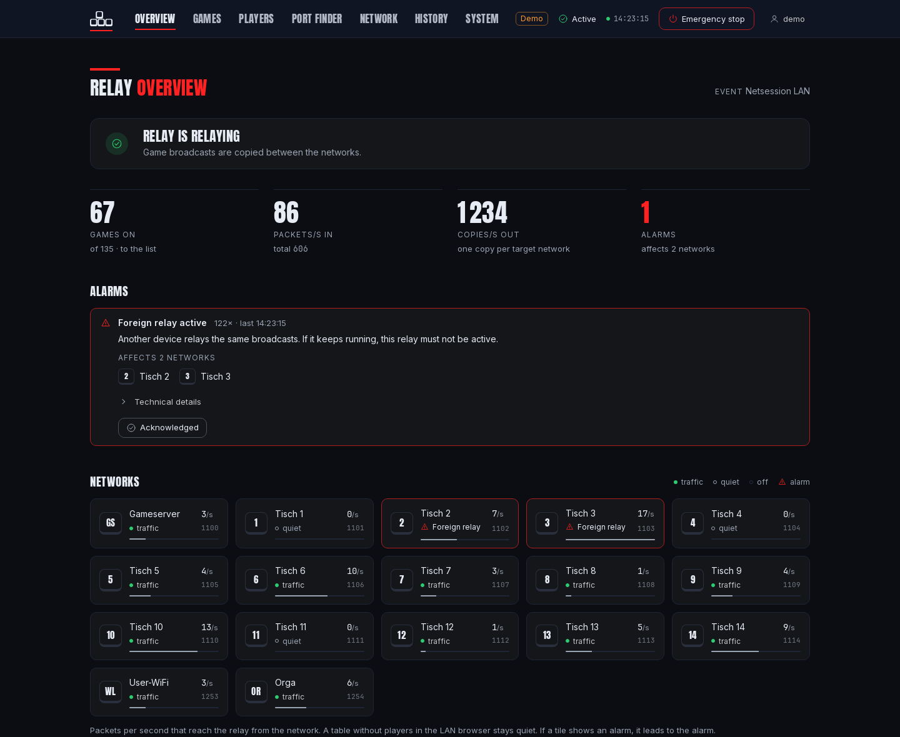
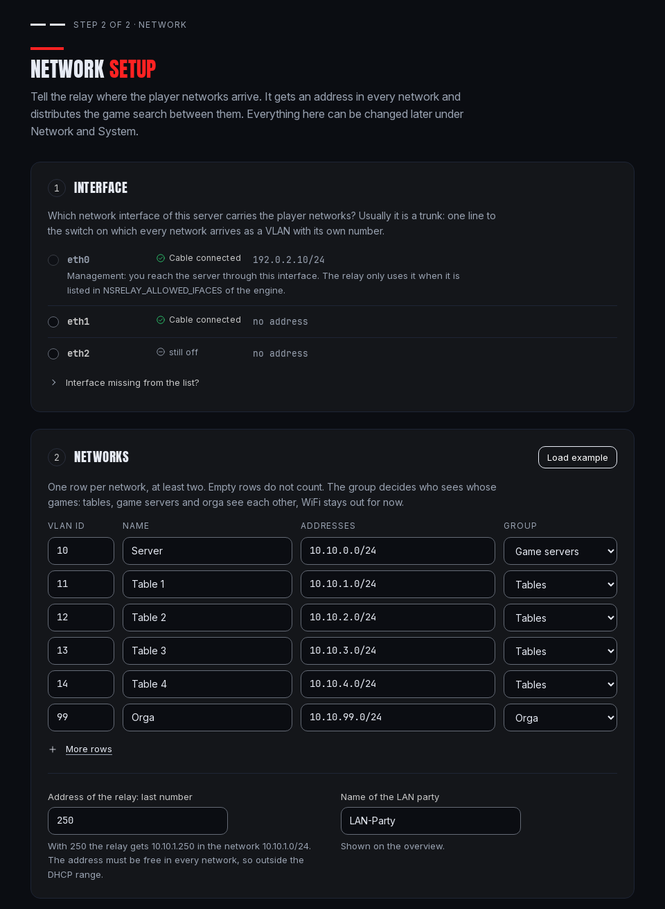
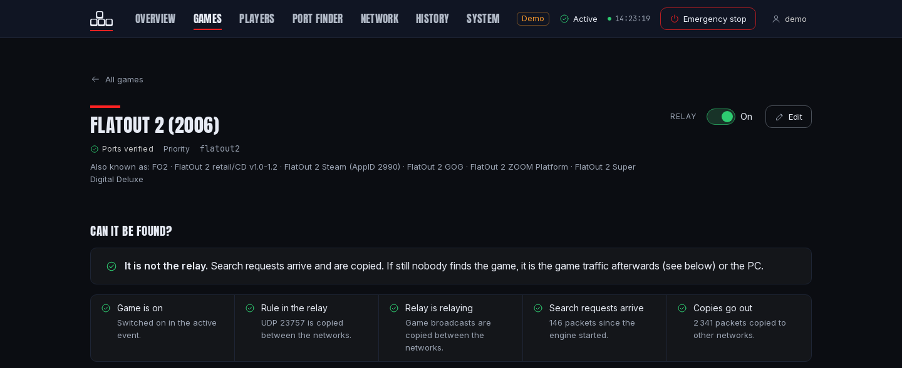
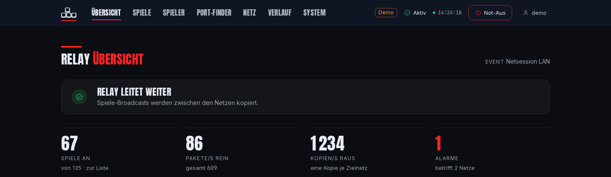
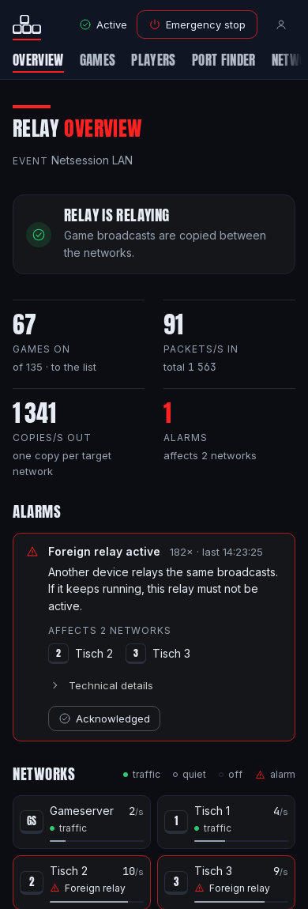
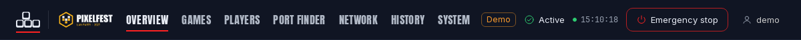
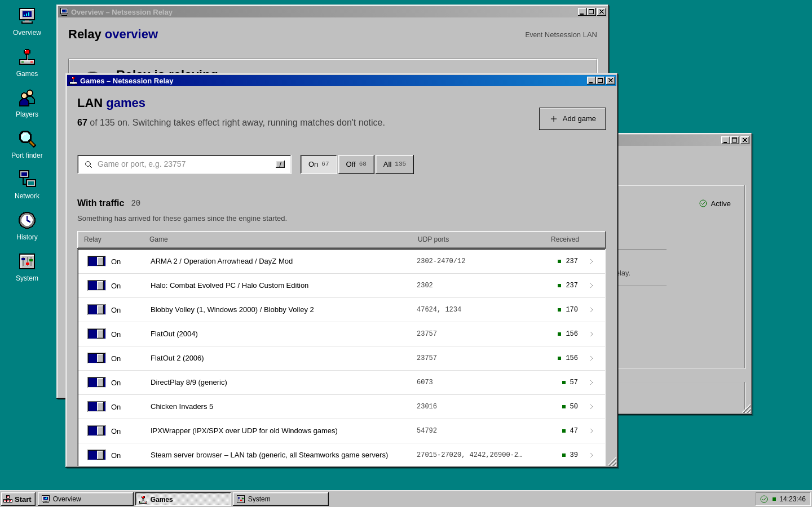

# Netsession Relay

[](https://github.com/Netsession2024/Netsession-Relay/actions/workflows/ci.yml)
[](https://github.com/Netsession2024/Netsession-Relay/releases)
[](LICENSE)

**Every table sees every LAN game again.**

You know the moment: the hall is full, the network is split into clean VLANs per table, and then somebody shouts
*"I'm hosting FlatOut, can you see me?"* – and only their own table can. Classic LAN games find each other by
broadcast, and broadcasts stop at the router.

Netsession Relay fixes exactly that. It sits in all your player networks and copies the "anyone hosting?" packets
between them, so the server browser at table 1 shows the game hosted at table 12. One container, a web UI your crew
can use at 3 a.m., and protection against the loops and broadcast storms that make relays scary.



## Start in two minutes

You need a Linux machine with Docker and one network port that carries your player VLANs (a trunk).

```sh
git clone https://github.com/Netsession2024/Netsession-Relay.git
cd Netsession-Relay
docker compose up -d
```

Open `http://<server>:8080` and the setup walks you through the rest: create the admin account, pick the trunk,
enter your networks. No configuration file, no command line. Start in *observe* mode to see what would be relayed
before it sends a single packet.



## What you get

- **About 150 games out of the box** – from Age of Empires, Counter-Strike and Unreal Tournament to FlatOut,
  Blobby Volley, Minecraft and Warcraft III, plus platforms like Steam's LAN tab and DirectPlay. Researched from
  source code, protocol docs, established LAN-party port lists and our own captures. Switch games on and off with
  one click.
- **"Can it be found?"** – every game has a diagnosis page that tells you in plain words whether the relay is the
  problem or the PC is.
- **Players at a glance** – who is searching and who is hosting right now, per table. Servers that only answer
  (CS2, Quake 3, Call of Duty) are found by a built-in server probe.
- **Port finder** – a game is missing? Start the finder, open the game's LAN browser, and the relay shows which
  ports it uses. One click turns that into a new game entry.
- **Safe by design** – loop and storm protection, rate limits per game, sender and network, a guard that keeps two
  relays from fighting, an emergency stop button, and a history with one-click rollback.
- **Shields its own host** – no routing between your player networks, and players reach neither SSH nor the web
  UI through the relay's addresses.
- **Fits your monitoring** – JSON and Prometheus endpoint, Zabbix templates, SNMP, syslog and OpenTelemetry.
- **Single sign-on** via OpenID Connect next to local accounts, with viewer, operator and admin roles.
- **Your event's logo** – upload the logo of your LAN party under **System** and it shows next to the Netsession
  Relay mark: in the header, on the overview and on the sign-in page.



## German and English

The whole web UI is available in **English and German** (Deutsch). Switch with one click in the account menu or on
the sign-in page; `NSRELAY_LANG=en` makes English the default for an install.



## On the phone

Every page works on a phone, so whoever walks through the hall has the relay in their pocket.



## Your LAN, your logo

Upload your event's logo (PNG or JPEG) under **System** and it appears next to the Netsession Relay mark – in the
header, on the overview, on the sign-in page and in the setup. The relay checks the image and stores a cleaned,
resized copy.



## The "98" desktop

For the late-night shift: switch the look to **98** in the account menu and the relay turns into a 1998 desktop –
Start menu, taskbar with clock, desktop icons, and every page as its own program in a window you can drag, resize,
minimise and close. Fully working, just for fun.



## Documentation

**[Getting started](docs/getting-started.md)** · [How it works](docs/architecture.md) ·
[Game database](docs/game-database.md) · [Running it at your LAN](docs/operations.md) ·
[Troubleshooting](docs/troubleshooting.md) · [Development and lab](docs/development.md) – also in the
[wiki](https://github.com/Netsession2024/Netsession-Relay/wiki).

Try the UI with invented data, without touching any network:
`docker run --rm -p 8080:8080 ghcr.io/netsession2024/netsession-relay web -demo -addr :8080`, then open
`http://localhost:8080` and sign in as `demo` / `demo`. Release binaries (linux amd64/arm64) and the image
`ghcr.io/netsession2024/netsession-relay` are on the
[releases page](https://github.com/Netsession2024/Netsession-Relay/releases).

## Under the hood

One Go process relays all games and networks (AF_PACKET, about 0.2 µs per packet). It keeps the original sender
address by default, because many games answer the sender directly. Loops are stopped by a source-subnet check and
deduplication across networks instead of packet marking, so even a second relay in the network cannot cause a
broadcast storm. Multicast games get IGMP joins so switches with IGMP snooping let them through. A network
namespace lab tests the real engine with VLANs, broadcasts, multicast, rate limits, a second relay and restarts, in
CI on every change.

```sh
go test ./...
bash lab/run-docker.sh      # network lab in a privileged container
```

## Add your game

A game is missing or a port is wrong? Add it to `games/games.yaml` (format in the file header), run
`go test ./internal/gamedb` and open a pull request with your sources – or just open an issue with what the port
finder showed. Captures from real LAN parties are the most valuable contribution. See
[CONTRIBUTING.md](CONTRIBUTING.md); changes are listed in [CHANGELOG.md](CHANGELOG.md).

## Thanks

- [udpbroadcastrelay](https://github.com/marjohn56/udpbroadcastrelay) (marjohn56, nomeata) – the relay we used
  before; its limits shaped this design.
- [service-discovery-helper](https://github.com/OpenSourceLAN/service-discovery-helper) (OpenSourceLAN) and
  [gamebridge](https://github.com/netwarlan/gamebridge) (NETWAR) – port lists tested at large LAN parties.
- The FlatOut community, especially the open-source multiplayer plugins by gaycoderprincess, for documenting the
  FlatOut LAN protocol.
- The [Netsession](https://netsession.net) crew – built and tested at our LAN parties.

## License

MIT for the code, see [LICENSE](LICENSE). The Netsession name and logo are not covered by the MIT license, but
you are welcome to keep them, unchanged, as the name and mark of the software. The logo of your own event goes
into the logo setting under **System**. Details, including the fonts, in [NOTICE.md](NOTICE.md).
